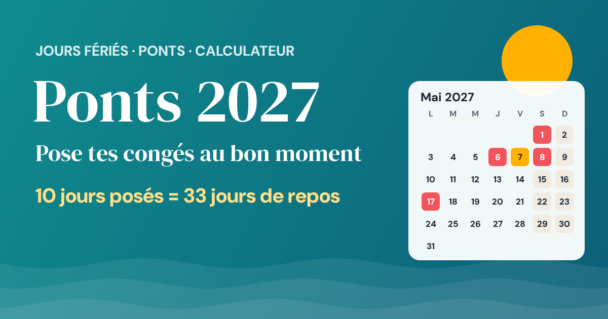

# 🏖️ Ponts 2027 : jours fériés et où poser ses congés

**Le calculateur qui te dit exactement quels jours de congés poser pour avoir le maximum de vacances.**

👉 **[Calculer mes ponts](https://cedricpoint.github.io/ponts-jours-feries/)**

## Ce que ça fait

- **Optimise tes congés** : tu indiques combien de jours tu peux poser, l'outil teste toutes les combinaisons et te donne les dates exactes. Exemple en 2027 : **10 jours posés = 33 jours de repos**.
- **Quatre styles de coupures** : ponts et week-ends prolongés, petites escapades (6 jours et +), vraies vacances (9 jours et +) ou grandes vacances (16 jours et +).
- **Tous les jours fériés** de l'année avec le jour de la semaine, les ponts possibles et ceux qui tombent un week-end.
- **Calendrier annuel** en couleurs : fériés, congés à poser, périodes de vacances.
- **Alsace-Moselle** (Vendredi saint et Saint-Étienne), option **lundi de Pentecôte travaillé** (journée de solidarité), et **jours travaillés personnalisables** (temps partiel, travail le samedi…).
- **Export agenda** (.ics) pour Google Agenda, Outlook ou l'iPhone.
- **Image à partager** et lien qui garde tes réglages.

## Jours fériés 2027 en France

| Date | Jour férié |
|---|---|
| Vendredi 1er janvier | Jour de l'an |
| Lundi 29 mars | Lundi de Pâques |
| Samedi 1er mai | Fête du Travail |
| Jeudi 6 mai | Ascension 🌉 |
| Samedi 8 mai | Victoire 1945 |
| Lundi 17 mai | Lundi de Pentecôte |
| Mercredi 14 juillet | Fête nationale |
| Dimanche 15 août | Assomption |
| Lundi 1er novembre | Toussaint |
| Jeudi 11 novembre | Armistice 🌉 |
| Samedi 25 décembre | Noël |

2027 est une année radine : 4 jours fériés tombent un week-end.

## Technique

- Un seul `index.html`, zéro dépendance, tout est calculé dans le navigateur.
- Date de Pâques par l'algorithme de Meeus/Jones/Butcher, fériés mobiles dérivés (Ascension = Pâques + 39 j, Pentecôte = Pâques + 50 j).
- Optimisation exacte par programmation dynamique (ordonnancement d'intervalles pondérés avec budget) : le résultat est le meilleur possible, pas une approximation.

## Licence

MIT
